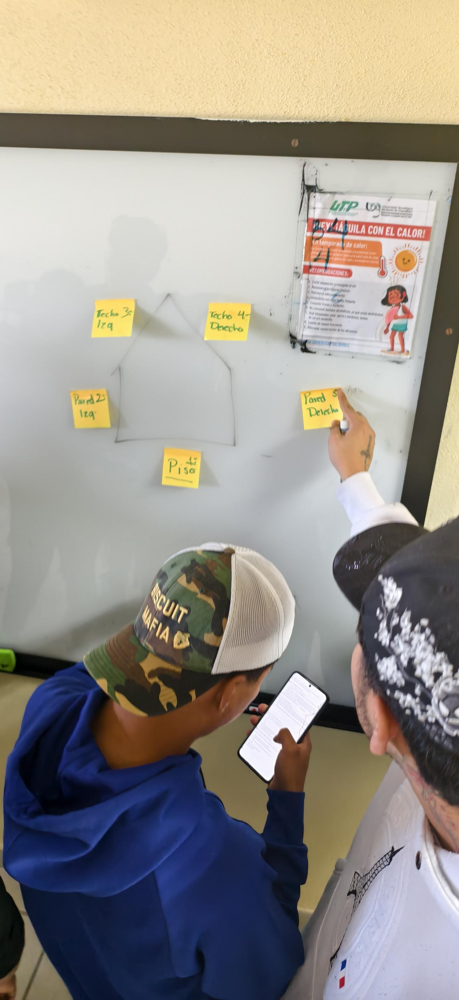
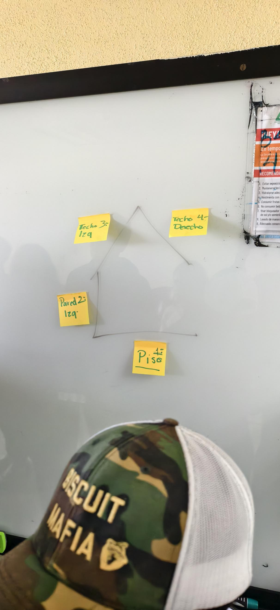
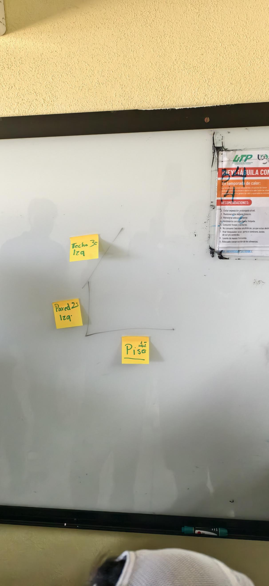

# Pilas

## Integrantes

- Jonathan Benancio Aguilar Hernández
- Angel Nahum Camarillo Solano
- Luis Fernando Campuzano Hernández
- Pedro García Mata
- Jose Alejandro Olvera Lugo

---

## Ronda 1: El estacionamiento (10 min)

**Objetivo:** Comprender las operaciones `push`, `pop` y por qué solo se puede acceder al elemento que está en el tope de la pila.

### 1. Entrada de los autos

Los alumnos representan autos que entran al callejón de uno en uno (`push`). El último en entrar queda hasta adelante.

### 2. Salida del auto azul

El docente solicita: **"¡Tiene que salir el auto azul!"**

Si el auto azul está al fondo, todos los autos que están delante deben salir (`pop`) y esperar en una calle lateral, que representa una segunda pila.

Después, el auto azul sale y los demás autos regresan en orden inverso al que salieron.

### 3. Primera imagen de la pila

### 4. Segunda imagen de la pila

### 5. Tercera imagen de la pila

---

## Pregunta de cierre

**¿Por qué no pudo salir el auto del fondo directamente?**

Porque la pila funciona con el principio LIFO (*Last In, First Out*), que significa «el último en entrar es el primero en salir». Los demás autos bloqueaban el paso del auto del fondo, por lo que tuvieron que salir primero y colocarse en otra pila. Después de que salió el auto azul, los demás regresaron en orden inverso al que salieron.

## Ronda 2: Ctrl+Z humano (8 min)

**Objetivo:** Comprender cómo funcionan las operaciones `push`, `pop`, `peek` e `isEmpty` mediante una pila que permite deshacer acciones.

### 1. Dibujar una casita (`push`)

Un alumno dibuja una casita en el pizarrón utilizando 5 trazos. Después de cada trazo, un compañero coloca una tarjeta en la pila con la descripción de lo que se dibujó.

Las tarjetas pueden ser:

- Techo
- Pared izquierda
- Pared derecha
- Puerta
- Ventana

Cada tarjeta se agrega a la pila mediante la operación `push`.

### 2. Deshacer un trazo (`pop`)

El docente grita: **«¡Ctrl+Z!»**. El compañero retira la tarjeta que está en el tope de la pila (`pop`) y el alumno borra el trazo correspondiente del pizarrón.

Por ejemplo, si la tarjeta de arriba dice «Ventana», se retira esa tarjeta y se borra la ventana de la casa. Las demás tarjetas permanecen en la pila.

### 3. Consultar el siguiente trazo (`peek`)

El docente pregunta: **«¿Qué trazo sigue deshaciendo?»**. El compañero observa la tarjeta que está en el tope de la pila mediante la operación `peek`, sin retirarla.

Por ejemplo, si la tarjeta de arriba dice «Puerta», esa sería la siguiente acción que se desharía al utilizar `Ctrl+Z`.

### 4. Comprobar si la pila está vacía (`isEmpty`)

El docente pregunta: **«¿Ya no hay nada que deshacer?»**. El compañero revisa si quedan tarjetas en la pila.

Para llegar a este paso, se deben retirar las tarjetas restantes una por una (`pop`) y borrar los trazos correspondientes. Cuando ya no quedan tarjetas y la casa está completamente borrada, la operación `isEmpty` devuelve `true`.

---

### Pregunta de cierre

**¿Por qué se deshace primero el último trazo realizado?**

Porque la pila funciona con el principio LIFO (*Last In, First Out*), que significa «el último en entrar es el primero en salir». Por eso, la última acción realizada es la primera que se deshace, como sucede al utilizar `Ctrl+Z` en un programa.
