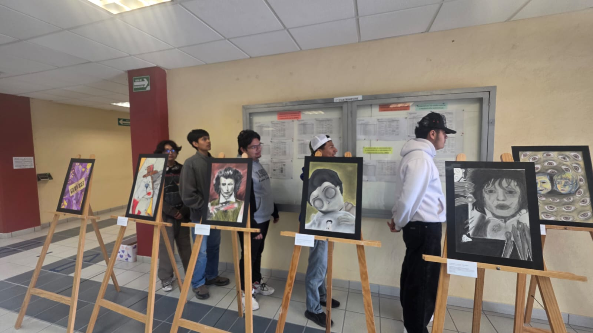
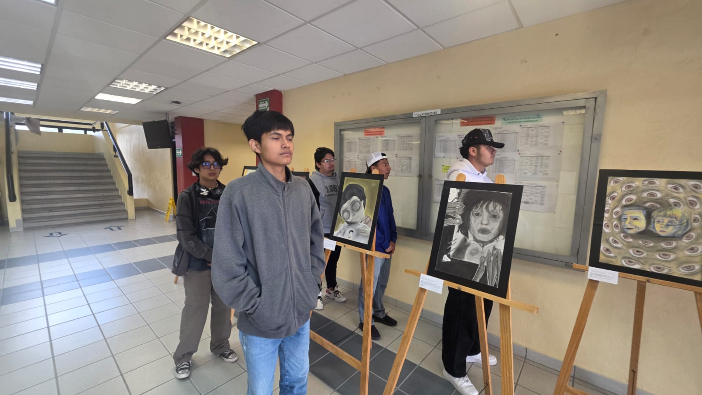
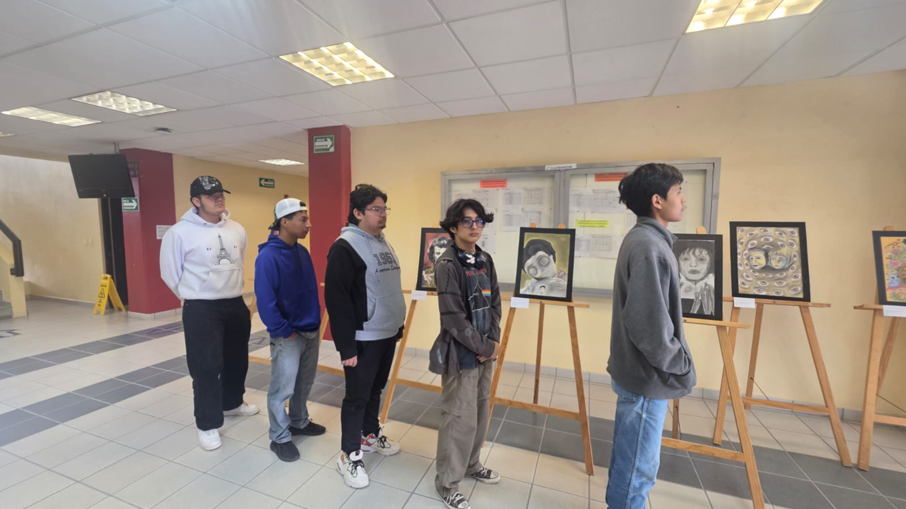

# Pilas
## Integrantes
Jonathan Benancio Aguilar Hernández
Angel Nahum Camarillo Solano
Luis Fernando Campuzano Hernández
Pedro García Mata
Jose Alejandro Olvera Lugo

## Ronda 1: El estacionamiento (10 min)
Idea: push, pop y por qué solo se accede al tope.
1. Los alumnos son autos y entran al callejón de uno en uno (push). El último en entrar queda
hasta adelante.
### Primera imagen de la pila

2. El docente solicita: "i Tiene que salir el auto azul!" Si el azul está al fondo, todos los que
están delante deben salir (pop) y esperar en una calle lateral, que es una segunda pila.
Después el azul sale y los demás regresan en orden inverso al que salieron.
### Segunda imagen de la pila

#### Tercera imagen de la pila

Pregunta para cerrar: 
¿por qué no pudo salir el del fondo directamente?
Porque la pila funciona con el principio LIFO (último en entrar, primero en salir). El auto del fondo no pudo salir directamente porque los 
demás autos bloqueaban su camino, así que tuvieron que salir primero y colocarse en otra pila. Después de que salió el auto azul, los demás 
regresaron en orden inverso al que salieron.
